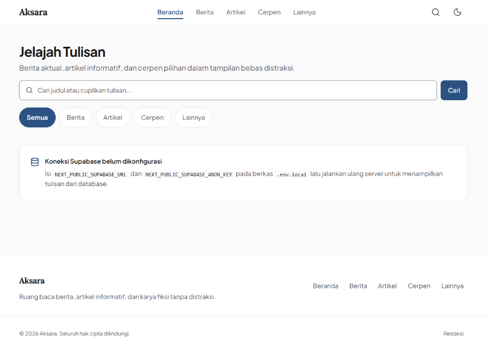

# Aksara

Platform publikasi digital modern, minimalis, dan *mobile-first* untuk membaca dan mengelola berbagai format tulisan: **Berita**, **Artikel**, **Cerpen**, dan konten lainnya tanpa distraksi visual.

---

## Pratinjau Tampilan



---

## Fitur Utama (Fase 1 — MVP)

### 1. Pengalaman Membaca (*Reading Experience*)
- **Editorial Minimalis:** Tata letak satu kolom (*single-column*) yang bersih dengan spasi lega agar nyaman dibaca berlama-lama.
- **Tipografi Otomatis:**
  - *Sans-serif* (*Plus Jakarta Sans*) untuk Berita dan Artikel yang faktual.
  - *Serif* (*Lora*) untuk Cerpen dan karya sastra guna memberikan nuansa membaca buku fisik.
- **Indikator Progres Baca:** *Scroll-driven reading progress bar* di bagian atas layar.
- **Kontrol Ukuran Font:** Tombol pintas `A-` / `A+` untuk kenyamanan ukuran huruf sesuai preferensi pembaca.
- **Dukungan Tema:** *Light Mode* dan *Dark Mode* tanpa *flicker* (*flash-free* via `next-themes`).
- **Fitur Berbagi:** Tombol instan salin tautan dan berbagi ke WhatsApp.

### 2. Eksplorasi & Navigasi (*Discovery*)
- **Filter Jenis Konten:** Tab filter horizontal ramah sentuhan jempol (*Semua*, *Berita*, *Artikel*, *Cerpen*, *Lainnya*).
- **Pencarian Cepat:** Pencarian tulisan berdasarkan judul dan cuplikan singkat.
- **Tulisan Pilihan (*Featured Post*):** Penempatan sorotan utama untuk tulisan kurasi redaksi.

### 3. CMS & Manajemen Redaksi (*Admin Dashboard*)
- **Autentikasi Terproteksi:** Autentikasi berbasis Supabase Auth dengan proteksi rute `/admin/*` di level middleware dan server.
- **Editor Kaya Fitur (*Rich Text Editor*):** Ditenagai oleh **Tiptap** (Heading, Bold, Italic, Blockquote, Bullet/Numbered List, Link, Undo/Redo).
- **Unggah Gambar Sampul:** Integrasi langsung dengan Supabase Storage bucket `covers`.
- **Manajemen Kategori & Status:** Pengaturan draft, publikasi, arsip, estimasi waktu baca otomatis, dan pembuatan kategori baru langsung dari editor.

### 4. SEO & Kinerja Optimal
- **Metadata Dinamis:** Open Graph & Twitter Cards otomatis di setiap artikel.
- **Sitemap & Robots Dinamis:** Generator `sitemap.xml` dan `robots.txt` otomatis untuk perayapan mesin pencari.
- **Aksesibilitas (a11y):** *Skip to main content link*, area sentuh (*tap target*) minimal 44x44px, dan semantik HTML standar.

---

## Tech Stack

- **Framework:** [Next.js](https://nextjs.org/) (App Router, Turbopack, React Server Components)
- **Language:** TypeScript
- **Styling:** [Tailwind CSS v4](https://tailwindcss.com/) + `@tailwindcss/typography`
- **Database & Auth:** [Supabase](https://supabase.com/) (PostgreSQL, Auth, Storage)
- **Rich Text Editor:** [Tiptap](https://tiptap.dev/)
- **Icons:** [Lucide React](https://lucide.dev/)
- **Theme:** [next-themes](https://github.com/pacocoursey/next-themes)
- **Sanitasi HTML:** `sanitize-html`

---

## Panduan Memulai (*Getting Started*)

### 1. Kloning Repositori & Instal Dependensi

```bash
git clone https://github.com/Dw3ls/News-web.git
cd news-web
npm install
```

### 2. Konfigurasi Lingkungan (*Environment Variables*)

Salin berkas `.env.example` menjadi `.env.local`:

```bash
cp .env.example .env.local
```

Isi variabel berikut sesuai kredensial proyek Supabase Anda:

```env
NEXT_PUBLIC_SUPABASE_URL=https://your-project-ref.supabase.co
NEXT_PUBLIC_SUPABASE_ANON_KEY=your-anon-key-here
NEXT_PUBLIC_SITE_URL=http://localhost:3000
```

### 3. Setup Skema Database & Storage

1. Buka dashboard proyek Supabase Anda lalu masuk ke menu **SQL Editor**.
2. Salin dan jalankan seluruh isi skema dari [`docs/schema.sql`](docs/schema.sql).
3. Buat bucket baru bernama `covers` di menu **Storage** Supabase (atur visibilitas menjadi *Public* agar gambar dapat diakses pembaca).
4. Setelah mendaftarkan akun pertama di `/login`, ubah `role` akun Anda di tabel `profiles` menjadi `admin` lewat Table Editor Supabase.

### 4. Jalankan Server Pengembangan

```bash
npm run dev
```

Buka [http://localhost:3000](http://localhost:3000) di browser Anda.

---

## Struktur Folder

```text
news-web/
├── docs/                 # Dokumentasi PRD, Desain, Skema DB, dan Aset
│   ├── assets/           # Screenshot dan gambar pendukung
│   ├── DESIGN.md         # Pedoman estetika dan tipografi
│   ├── PRD.md            # Product Requirements Document
│   ├── schema.sql        # Skema PostgreSQL & RLS Supabase
│   └── TASKS.md          # Roadmap & progress implementasi
├── src/
│   ├── app/
│   │   ├── (public)/     # Beranda (/) dan Detail Baca (/baca/[slug])
│   │   ├── admin/        # Dashboard (/admin) dan Editor (/admin/editor)
│   │   ├── login/        # Halaman autentikasi redaksi (/login)
│   │   ├── robots.ts     # Robots.txt dinamis
│   │   └── sitemap.ts    # Sitemap.xml dinamis
│   ├── components/
│   │   ├── admin/        # Komponen editor Tiptap, tabel admin
│   │   ├── reading/      # Progress bar, pembaca artikel, share buttons
│   │   └── ui/           # Header, footer, card, filter, tema toggle
│   ├── lib/              # Helper Supabase, sanitasi, slug, format tanggal
│   └── types/            # Definisi tipe TypeScript
└── README.md
```

---

## Lisensi

Proyek ini dikembangkan secara independen untuk publikasi digital. Seluruh hak cipta dilindungi &copy; 2026 Aksara.
